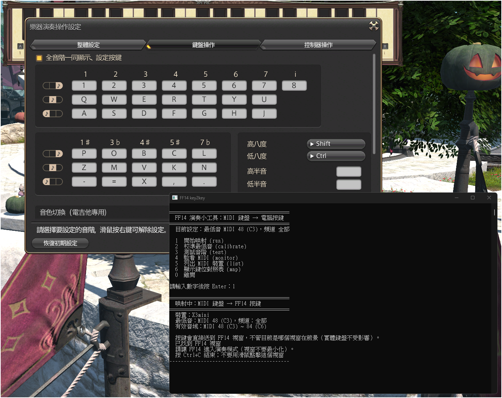

# ff14-bard-midi-key2key

[English](README.md) | [正體中文](README-ZH.md)

用 MIDI 鍵盤彈 FINAL FANTASY XIV 的樂器。

不需要安裝任何套件，也不會改動遊戲。它把 MIDI 鍵盤的琴鍵訊號轉成一般電腦鍵盤的按鍵，並以背景輸入的方式送給遊戲。因此視窗不必停在 FF14 上，你可以一邊看樂譜、一邊演奏。

把 37 鍵的 USB MIDI 鍵盤（作者使用 MIDIPLUS X3 mini）的每個琴鍵，轉成 FF14 演奏模式的按鍵，讓你直接用 MIDI 鍵盤彈奏遊戲裡的樂器。
FF14 的樂器剛好是 37 個音（含黑鍵，C3 ~ C6），和 37 鍵的 MIDI 鍵盤一一對應。僅支援 Windows。



## 特色

- **一個琴鍵對一個按鍵**：37 個音各自有獨立按鍵，不使用 Shift / Ctrl。完整對照表見 [KEYMAP.md](KEYMAP.md)。
- **焦點不在遊戲也能彈**：按鍵訊息直接送給 FF14 視窗，你可以一邊彈奏、一邊在瀏覽器等其他視窗操作；用電腦鍵盤打字不受影響。
- **第一次用會自動帶你校準**，不必懂 MIDI 音符編號。
- **不用安裝任何東西**：用 Windows 內建的 C# 編譯器，雙擊 `build.bat` 就能編譯。

## USAGE

### 需求

- Windows 10 / 11
- FINAL FANTASY XIV 繁體中文版（遊戲程式 `ffxiv_dx11.exe`）
- 一台 USB MIDI 鍵盤。37 鍵最理想；不是 37 鍵也可以，校準時請照下方說明做。

### 1. 設定遊戲內的按鍵

這個程式只負責「MIDI 琴鍵 → 按鍵」，遊戲裡的按鍵要和下表一致（也就是上面截圖的設定）。

進入遊戲後開啟演奏模式 →「樂器演奏操作設定」→「鍵盤操作」分頁，**勾選「全音階一同顯示、設定按鍵」**，然後照表設定：

| 八度 | 白鍵 1 2 3 4 5 6 7 | 黑鍵 1# 3b 4# 5# 7b |
|---|---|---|
| 高八度 | `1` `2` `3` `4` `5` `6` `7`（最高音 i = `8`） | `P` `O` `B` `C` `L` |
| 中八度 | `Q` `W` `E` `R` `T` `Y` `U` | `Z` `M` `V` `K` `N` |
| 低八度 | `A` `S` `D` `F` `G` `H` `J` | `-` `=` `X` `,` `.` |

「高八度／低八度」修飾鍵（Shift / Ctrl）維持預設即可，程式不會用到。

### 2. 取得程式

**簡單的方式：直接下載。** 開啟 [Releases 頁面](https://github.com/aqzhyi/ff14-bard-midi-key2key/releases)，下載 `ff14-key2key.exe`。這個檔案由 GitHub 自動以本倉庫的原始碼編譯。放在任何資料夾都可以。

因為檔案沒有數位簽章，Windows 可能顯示警告（「Windows 已保護您的電腦」）。你可以驗證檔案：從同一頁下載 `ff14-key2key.exe.sha256`，再執行 `certutil -hashfile ff14-key2key.exe SHA256`，把結果和該檔案裡的數字比對。

**或是自己編譯。**

1. 把這個倉庫下載下來（Code → Download ZIP，解壓縮），或用 `git clone`。
2. 雙擊 `csharp\build.bat`。成功會看到 `SUCCESS`，並產生 `csharp\ff14-key2key.exe`。

編譯用的是 Windows 內建的 .NET Framework C# 編譯器（`csc.exe`），不需要另外安裝 Visual Studio 或 SDK。

### 3. 啟動

1. 把 MIDI 鍵盤接上電腦。關閉其他正在使用 MIDI 的程式（例如 DAW），因為 Windows 的 MIDI 輸入通常一次只能被一個程式使用。
2. 雙擊 `ff14-key2key.exe`。Windows 詢問「是否允許變更」時按「是」。

   程式一律要求系統管理員權限：FF14 若是以系統管理員執行，Windows 會擋掉一般權限程式送給它的按鍵，而且不會報錯。
3. 出現選單：

   | 選項 | 功能 |
   |---|---|
   | 1 開始映射 | 正式使用 |
   | 2 校準最低音 | 重新設定「最左邊的琴鍵 = 哪個 MIDI 音」 |
   | 3 測試音階 | 自動按一遍 37 個音，確認遊戲裡的鍵位（不需要 MIDI 鍵盤） |
   | 4 監看 MIDI | 只顯示收到的音符，**不會**按任何鍵，用來排查問題 |
   | 5 列出 MIDI 裝置 | 看電腦有沒有認到鍵盤 |
   | 6 顯示鍵位對照表 | 把 37 鍵對照表印出來 |
   | 0 離開 | 關閉程式 |

### 4. 第一次：校準

第一次選 `1` 時，程式會先帶你校準，照畫面做：

1. 按鍵盤**最左邊（最低音）**的琴鍵。
2. 再按**最右邊（最高音）**的琴鍵。

兩個琴鍵要剛好差 36 個半音（37 鍵），程式會檢查。結果存在 `ff14-key2key.exe` 旁邊的 `config.txt`，之後不用再做。
校準之後，請不要再動鍵盤上的 Octave（八度）或 Transpose（移調）。

如果你的鍵盤不是 37 鍵：校準時改按「你想當成 FF14 最低音 C 的琴鍵」，以及從它往上數第 36 個半音的琴鍵。

### 5. 彈奏

1. 在選單輸入 `1` 按 Enter，畫面會出現「已找到 FF14 視窗」。
2. 在 FF14 裝備樂器並進入演奏模式。
3. 開始彈。程式視窗保持開著即可，焦點在哪個視窗都沒關係。
4. 結束時按 `Ctrl+C` 或直接關掉視窗，所有按鍵都會自動放開。

小提醒：彈奏時建議不要用滑鼠點程式的黑色視窗。

### 6. 驗證（建議）

- 選 `3` 測試音階：程式會自己從最低音按到最高音。聽到音階由低到高、沒有跳音，就代表遊戲鍵位和程式一致。
- 選 `4` 監看 MIDI：按琴鍵會顯示收到的音符與對應的按鍵，但不會送出任何按鍵。

## 設定檔 `config.txt`

校準會自動寫好，放在 `ff14-key2key.exe` 旁邊，一般不用手動改。

```
base_note=48   # 鍵盤最左邊琴鍵的 MIDI 音符編號（C3 = 48）
device=        # MIDI 裝置名稱的一部分；留空 = 自動選擇
channel=0      # 0 = 接收所有頻道
```

## 疑難排解

- **遊戲沒反應**：先看視窗有沒有顯示「已找到 FF14 視窗」。程式只認遊戲本體（`ffxiv_dx11.exe`、視窗類別 `FFXIVGAME`），
  不會把按鍵送給啟動器或其他視窗。找不到時，程式會列出標題像 FF14 的視窗，請把它貼在 Issue 裡。
- **有找到視窗但沒聲音**：先用選單 3 測試音階；再確認遊戲在演奏模式、已裝備樂器，而且遊戲內的鍵位和上方表格一致。
- **找不到 MIDI 裝置**：換一個 USB 孔、重新插拔，並關掉其他使用 MIDI 的程式。
- **按了琴鍵顯示「超出範圍」**：鍵盤的 Octave 或 Transpose 被動過了，請回到校準時的設定，或重新校準（選單 2）。
  有「智慧音階」功能的鍵盤請關掉，保持一般琴鍵模式。
- **音階測試是對的，用鍵盤彈卻是錯的音**：重新校準。
- **按鍵跑出注音符號**：把輸入法切到英文模式。
- **編譯失敗**：確認 `Key2Key.cs`、`app.manifest`、`build.bat` 都在 `csharp\` 資料夾，並把畫面貼在 Issue 裡。

## 運作原理

- 用 Windows 的 `winmm` 讀取 MIDI 輸入，用 `PostMessage` 把「按下／放開」的按鍵訊息直接投遞給 FF14 視窗，所以不需要視窗有焦點。
- 程式只對遊戲視窗送出一般的 Windows 按鍵訊息；不讀取、不修改遊戲記憶體，也不注入遊戲程序，更不會自動演奏。
- 遊戲沒開時按鍵會被忽略；遊戲開啟或重開後，程式會自動接上。

## 資料夾

| 路徑 | 說明 |
|---|---|
| `README.md` | 英文說明（English） |
| `README-ZH.md` | 正體中文說明（本文件） |
| `csharp\Key2Key.cs` | 程式原始碼（單一檔案，C# 5） |
| `csharp\app.manifest` | 要求系統管理員權限 |
| `csharp\build.bat` | 編譯腳本 |
| `.github\workflows\release.yml` | 自動編譯並在 GitHub 發布 exe |
| `KEYMAP.md` | 37 鍵對照表 |
| `docs\screenshot.png` | 說明文件的截圖 |

編譯出來的 `ff14-key2key.exe` 和你的校準檔 `config.txt` 不會進版本控制（見 `.gitignore`）。

## 免責聲明

使用第三方軟體可能違反遊戲的服務條款，風險請自行評估。本程式只做按鍵映射，但作者不保證不會被遊戲營運方視為違規。
作者僅在 MIDIPLUS X3 mini 與 FF14 繁體中文版上實測過。

## 授權

以 [BSD 3-Clause License](LICENSE) 授權。
