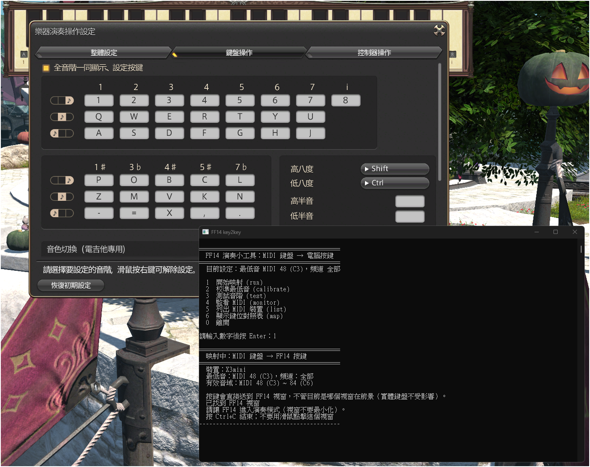
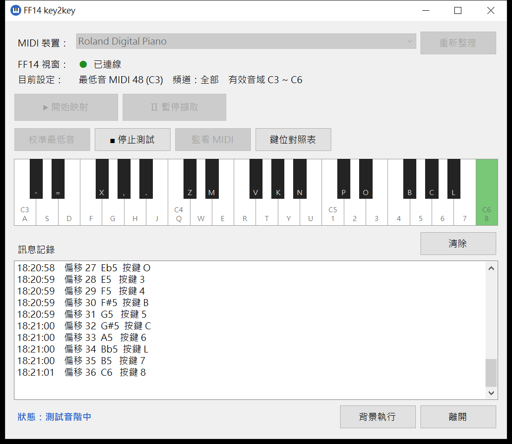

# ff14-bard-midi-key2key

[English](README.md) | [正體中文](README-ZH.md)

Play FINAL FANTASY XIV instruments with a MIDI keyboard.

This tool needs no extra software. It does not change the game. It changes the keys of your MIDI keyboard into normal computer keys. It sends the keys to the game in the background. So the game window does not need to be in front. You can read sheet music in another window and play at the same time.

The tool works with a USB MIDI keyboard that has 37 keys. The author uses a MIDIPLUS X3 mini. Each MIDI key becomes one key for FF14 performance mode. An FF14 instrument has exactly 37 notes (C3 to C6, with the black keys). So a 37-key MIDI keyboard fits it one to one. Windows only.



## Features

- **One MIDI key is one computer key.** All 37 notes have their own keys. The tool does not use Shift or Ctrl. The full list is in [KEYMAP.md](KEYMAP.md).
- **It works when the game is not in front.** The key messages go straight to the FF14 window. You can use your browser while you play. Your normal keyboard still works as usual.
- **The first run helps you set up.** You do not need to know MIDI note numbers.
- **There is a window version.** You use every function with buttons. One button pauses and resumes. The program can also hide in the system tray and keep running. The console version is still there too.
- **It follows the octave buttons.** If you press OCTAVE or TRANSPOSE on the keyboard by mistake, the program moves with it. You do not need to calibrate again.
- **Other buttons do not stop it.** The other buttons, knobs and touch strips of the keyboard (for example Play and Stop buttons, which send SysEx) do not press any key, and they cannot stop the mapping.
- **You do not need to install anything.** It uses the C# compiler that is already in Windows. Double-click `build.bat` to make the program.



## USAGE

### What you need

- Windows 10 or 11
- FINAL FANTASY XIV, Traditional Chinese version (the game program is `ffxiv_dx11.exe`)
- A USB MIDI keyboard. A 37-key keyboard is best. Other sizes also work. See "4. First time: calibrate" below.

### 1. Set the keys in the game

This tool only changes "MIDI key to computer key". The keys in the game must be the same as this table. They are also in the screenshot above.

Start performance mode in the game. Open "Instrument Performance Settings" (樂器演奏操作設定), then the "Keyboard" tab (鍵盤操作). **Turn on** "Show and set all scales together" (全音階一同顯示、設定按鍵). Then set the keys like this table:

| Octave | White keys 1 2 3 4 5 6 7 | Black keys 1# 3b 4# 5# 7b |
|---|---|---|
| High | `1` `2` `3` `4` `5` `6` `7` (highest note i = `8`) | `P` `O` `B` `C` `L` |
| Middle | `Q` `W` `E` `R` `T` `Y` `U` | `Z` `M` `V` `K` `N` |
| Low | `A` `S` `D` `F` `G` `H` `J` | `-` `=` `X` `,` `.` |

Keep the "high octave" and "low octave" keys (Shift and Ctrl) as the default. This tool does not use them.

### 2. Get the program

There are two versions of the program. They do the same things and use the same `config.txt`:

| File | Version |
|---|---|
| `ff14-key2key-gui.exe` | **Window version (we suggest this).** Buttons, pause and resume, run in the background |
| `ff14-key2key.exe` | Console version. You type numbers in a menu |

**Easy way: download it.** Open the [Releases page](https://github.com/aqzhyi/ff14-bard-midi-key2key/releases). Download `ff14-key2key-gui.exe` (or `ff14-key2key.exe`). GitHub builds these files by itself from the source code in this repository. Put the file in any folder.

Windows may show a warning ("Windows protected your PC"), because the files have no digital signature. You can check a file: download its `.sha256` file from the same page (for example `ff14-key2key-gui.exe.sha256`). Then run `certutil -hashfile ff14-key2key-gui.exe SHA256` and compare the result with the number in that file.

**Or build it yourself.**

1. Download this repository (Code, then Download ZIP, then unzip it). Or use `git clone`.
2. Double-click `csharp\build.bat`. If it works, you see `SUCCESS`. The files `csharp\ff14-key2key-gui.exe` and `csharp\ff14-key2key.exe` are made.

The build uses the C# compiler (`csc.exe`) of .NET Framework. It is already in Windows. You do not need Visual Studio or an SDK.

To check the code, double-click `csharp\test.bat`. It builds and runs the unit tests (no MIDI keyboard or game needed). If all tests pass, you see `SUCCESS`. GitHub runs the same tests for every push and every pull request.

### 3. Start the program

1. Connect your MIDI keyboard. Close other programs that use MIDI, for example a DAW. In Windows, usually only one program can use a MIDI input at one time.
2. Double-click `ff14-key2key-gui.exe` (window version) or `ff14-key2key.exe` (console version). Windows may ask "Do you want to allow this app to make changes?". Click "Yes".

   The program always asks for administrator rights. If FF14 runs as administrator, Windows blocks keys from a normal program. It does not show an error.

The buttons of the **window version** (the words in the program are Chinese):

| Button | What it does |
|---|---|
| MIDI device (MIDI 裝置) / Refresh (重新整理) | Choose your MIDI keyboard. After you plug a keyboard in or out, click Refresh |
| Start mapping (▶ 開始映射) / Stop mapping (■ 停止映射) | Start or stop changing MIDI keys into computer keys. Stop also closes the MIDI device, so other programs can use it |
| Pause (Ⅱ 暫停擷取) / Resume (▶ 繼續擷取) | While mapping, stop sending keys to the game for a while. Held keys are let go at once. Click again to resume at once |
| Octave follow (自動跟隨八度) checkbox | Follow the OCTAVE and TRANSPOSE buttons of the keyboard. On by default. You can change it while mapping. Untick it if your keyboard does not have 37 keys. See step 4 |
| Calibrate (校準最低音) | Set again which MIDI note is the far left key |
| Test scale (測試音階) | The program presses all 37 keys by itself. Use it to check the keys in the game. You do not need a MIDI keyboard |
| Monitor MIDI (監看 MIDI) | It shows every MIDI message it gets: notes, and also other buttons and knobs (CC, Program Change, Pitch Bend, SysEx such as MMC Play or Stop, and so on). Other messages are marked 「（不影響按鍵）」 (does not press a key). It does **not** press any key. Use it to find problems |
| Key table (鍵位對照表) | Opens a window with the table of 37 keys |
| Run in background (背景執行) | Hides the window in the system tray (bottom right). Mapping keeps working. Double-click the icon to show the window again. Right-click it to pause, resume or exit |
| Exit (離開) | Lets go of all keys and closes the program. The ✕ button of the window does the same |

The color of the tray icon shows the state: grey = idle, green = mapping, yellow = paused, blue = calibrating, testing or monitoring. Only one window version can run at a time. If you start it again, the window that is already open comes to the front.

The **console version** shows a menu:

   | Option | What it does |
   |---|---|
   | 1 Start mapping (開始映射) | Use the tool |
   | 2 Calibrate the lowest note (校準最低音) | Set again which MIDI note is the far left key |
   | 3 Test scale (測試音階) | The program presses all 37 keys by itself. Use it to check the keys in the game. You do not need a MIDI keyboard. |
   | 4 Monitor MIDI (監看 MIDI) | It shows every MIDI message it gets: notes, and also other buttons and knobs (CC, Pitch Bend, SysEx and so on). Other messages are marked 「（不影響按鍵）」 (does not press a key). It does **not** press any key. Use it to find problems. |
   | 5 List MIDI devices (列出 MIDI 裝置) | See if the PC finds your keyboard |
   | 6 Show the key table (顯示鍵位對照表) | Print the table of 37 keys |
   | 0 Exit (離開) | Close the program |

### 4. First time: calibrate

The first time you click "Start mapping" (in the console version: choose `1`), the program helps you set up. Follow the screen:

1. Press the **lowest** key (the far left key) on your keyboard.
2. Press the **highest** key (the far right key).

The two keys must be exactly 36 semitones apart (a 37-key keyboard). The program checks this. The result is saved in `config.txt` next to the exe. You do not need to do it again.

The OCTAVE and TRANSPOSE buttons above the keys of a MIDI keyboard do not send a message. They only change the note number of every key. The program follows this by itself ("octave follow", on by default). When a note outside the 37-note window arrives, the program moves the window to fit it. It prints a line that starts with 「自動跟隨八度：鍵盤的音高移動了，已重新對齊」 and lets go of all held keys. You do not need to calibrate again.

One limit: the program can only see the move when you play a key that is now outside the old range. Right after an accidental press, a few notes may sound one octave off. Play a note near the top or the bottom of the keyboard. After that it is correct.

On MIDIPLUS X mini keyboards, press both OCTAVE buttons together to reset the octave.

The calibration also sets octave follow: if the two keys are not 36 semitones apart, it turns octave follow off.

If your keyboard does not have 37 keys: press the key you want to use as the lowest C of FF14. Then press the key that is 36 semitones higher. Then turn octave follow off yourself (window version: untick 「自動跟隨八度」; console version: set `follow_octave=0` in `config.txt`). If you do not, playing a key outside the 37 notes moves the window.

### 5. Play

**Window version**

1. Click "▶ 開始映射" (Start mapping). When "FF14 視窗" shows a green light and "已連線" (connected), the game was found.
2. In FF14, equip an instrument and start performance mode.
3. Play. The keys you press light up on the keyboard picture. To keep your desktop tidy, click "背景執行" (Run in background).
4. To stop sending keys for a while (for example, to do something else on the keyboard), click "Ⅱ 暫停擷取" (Pause). Click it again to resume.
5. To stop, click "■ 停止映射" (Stop mapping) or "離開" (Exit). The program lets go of all keys by itself.

**Console version**

1. Type `1` in the menu and press Enter. The screen shows "已找到 FF14 視窗" ("FF14 window found").
2. In FF14, equip an instrument and start performance mode.
3. Play. Keep the program window open. It does not matter which window is in front.
4. To stop, press `Ctrl+C` or close the window. The program lets go of all keys by itself.

Tip: with the console version, do not click the black program window with the mouse while you play.

### 6. Check (we suggest this)

- Test scale (console version: choose `3`). The program plays from the lowest note to the highest note by itself. If the scale goes up and there are no wrong notes, the keys in the game are the same as the keys in the program.
- Monitor MIDI (console version: choose `4`). When you press a key, the program shows the note and the computer key. It also shows the other buttons, knobs and touch strips of the keyboard (CC like Sustain, Modulation and Volume, Program Change, Pitch Bend, pressure, and SysEx such as MMC Play or Stop). Use this to see what a button sends. It does not send any key.

## Config file `config.txt`

The calibration makes this file. It is next to `ff14-key2key.exe`. Most people do not need to change it.

```
base_note=48   # MIDI note number of the far left key (C3 = 48)
device=        # Part of the MIDI device name. Empty = choose automatically
channel=0      # 0 = all channels
chord_spread_ms=0   # Chord spread in milliseconds. 0 = off, 10 to 200 = on
follow_octave=1     # 1 = follow the octave buttons (default), 0 = off. Turn off if your keyboard is not 37 keys
```

### Chord spread

FF14 performance mode plays only one note at a time. When you press several keys together, the game usually plays only one of them, and which one is not fixed.
Turn on "chord spread" (window version: tick "和弦錯開" in the main window; console version: set `chord_spread_ms` in `config.txt`):

- Notes you press together are sent **from low to high**, one after another, with the set number of milliseconds between them. It sounds like a fast broken chord. The last note, which keeps sounding, is the highest one (usually the melody).
- Only notes you pressed are spread. The program never makes or repeats a note by itself. A note you let go before it is sent is cancelled.
- When it is on, each note is about 8 ms later (to see which notes were pressed together). Later notes of a chord come later.
- Start with 30 ms. If notes are still lost, use a larger number. In the window version you can change it while mapping, and it works at once.
- This does not make the game play a real chord. It only gives each note a chance to be heard. Decide yourself whether this fits the rules of the game.

## Troubleshooting

- **Nothing happens in the game.** Look at the program window. Does it show "已找到 FF14 視窗" ("FF14 window found")? The program only finds the game itself (`ffxiv_dx11.exe`, window class `FFXIVGAME`). It does not send keys to the launcher or other windows. If it cannot find the game, it shows a list of windows with a title like FF14. Please paste the list in an Issue.
- **The window is found, but there is no sound.** First run option 3 (test scale). Then check these things: the game is in performance mode, you equipped an instrument, and the keys in the game are the same as the table above.
- **No MIDI device is found.** Use another USB port. Unplug the keyboard and plug it in again. Close other programs that use MIDI.
- **The program says "超出範圍" (out of range) when you press a key.** With octave follow on, this should not happen. If it does, octave follow is off: `follow_octave=0` in `config.txt`, or the keyboard was not calibrated as 37 keys. Turn it on (window version: tick 「自動跟隨八度」), or calibrate again. If your keyboard has a "smart scale" function, turn it off.
- **After I pressed a small button on the keyboard, no key works any more.** This was a bug in old versions. It is fixed. Please use the newest version. Many keyboards send SysEx from their buttons. For example, the 6 buttons of the MIDIPLUS X mini series send MMC transport commands (Play, Stop and so on). With the new MIDI system of Windows 11 (Windows MIDI Services), the old program stopped getting all MIDI input after a SysEx came in. You had to restart it. The new version gets buffers ready for SysEx first, so these buttons have no effect now. Monitor MIDI also shows the SysEx they send.
- **After I pressed a small button on the keyboard, the notes are wrong (there is sound, but wrong notes, or some keys do nothing).** The OCTAVE or TRANSPOSE button moved the note numbers. Octave follow (see step 4) fixes this by itself. But the program can only notice it when you play a key outside the old range. So a few notes may be one octave off at first. Play a note near the top or bottom of the keyboard, and it is correct. On MIDIPLUS X mini keyboards, press both OCTAVE buttons together to reset the octave. To see what a button sends, use Monitor MIDI. Also on the X mini series: while you hold SHIFT, the keys become setting keys and the keyboard sends no notes. Release SHIFT. To reset the keyboard to factory settings: unplug it, hold buttons 1 and 2, plug in the USB cable, and release after about 3 seconds.
- **The test scale is right, but your playing has wrong notes.** Calibrate again.
- **Zhuyin symbols appear when you press keys.** Change your input method to English mode.
- **You press several keys together, but the game plays only one.** This is a limit of FF14 (one note at a time). The program is not broken. You can turn on "Chord spread" (see above). This is also why you usually hear only one note in the "C major chord" at the end of the test scale.
- **No sound after you click Pause.** This is normal. While paused, no keys go to the game. Click Resume.
- **You cannot find the program window.** It may be in the system tray. Double-click the piano icon in the notification area (bottom right). Or start `ff14-key2key-gui.exe` again: the window that is already open comes to the front.
- **The build fails.** Check that `Key2Key.cs`, `Gui.cs`, `app.manifest`, `app.gui.manifest` and `build.bat` are all in the `csharp\` folder. Paste the screen in an Issue. If it says an exe is still running, close it first (also check the system tray).

## How it works

- The tool reads MIDI input with the Windows `winmm` library. It sends "key down" and "key up" messages to the FF14 window with `PostMessage`. So the window does not need to be in front.
- The tool always gets buffers ready for SysEx messages, even though it does not use them. With the new MIDI system of Windows 11 (Windows MIDI Services), MIDI input can stop when a SysEx message arrives and there is no buffer for it.
- The tool only sends normal Windows key messages to the game window. It does not read or change the game memory. It does not put code into the game process. It does not play music by itself.
- If the game is not open, the tool ignores the keys. When you open or restart the game, the tool connects again by itself.

## Files

| Path | What it is |
|---|---|
| `README.md` | English README |
| `README-ZH.md` | Traditional Chinese README (正體中文) |
| `csharp\Key2Key.cs` | The core and the console version (C# 5) |
| `csharp\Gui.cs` | The window version (WinForms, C# 5; built together with `Key2Key.cs`) |
| `csharp\app.manifest` | Console version: asks for administrator rights |
| `csharp\app.gui.manifest` | Window version: asks for administrator rights, supports high DPI |
| `csharp\build.bat` | The build script (makes both exe files) |
| `csharp\Tests.cs` | The unit tests (C# 5; built together with `Key2Key.cs`) |
| `csharp\test.bat` | Builds and runs the unit tests |
| `.github\workflows\release.yml` | Builds the exe files and makes the release on GitHub |
| `.github\workflows\test.yml` | Runs the unit tests on GitHub for every push and pull request |
| `KEYMAP.md` | The table of 37 keys |
| `docs\screenshot.png`, `docs\screenshot-gui.png` | The screenshots in this README |
| `docs\PRD-GUI.md` | The plan for the window version (Chinese) |

The built files `ff14-key2key.exe`, `ff14-key2key-gui.exe` and `ff14-key2key-tests.exe` and your calibration file `config.txt` are not in version control (see `.gitignore`).

## Disclaimer

Using other software with a game may break the rules of the game. You use this tool at your own risk. This tool only changes keys, but the author cannot promise that the game company will accept it. The author only tested it with a MIDIPLUS X3 mini and the FF14 Traditional Chinese version.

## License

This project uses the [BSD 3-Clause License](LICENSE).
